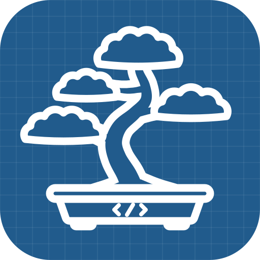

#  Sensei

A Claude Code plugin where you write the code and Claude teaches.

Claude plans the work with you and writes tests that fail until your code does what the task asks. Then it gives hints in small drips and reviews what you wrote. It never writes the solution and it never commits, so you practise the whole loop yourself.

Sensei is derived from [Foreman](https://github.com/myrheimb/foreman), which keeps the plan in your repo and works one approved phase at a time. Foreman has Claude build the software. Sensei keeps the planning discipline and hands the coding back to you.

## Install

```
/plugin marketplace add myrheimb/sensei
/plugin install sensei@sensei
```

## The four commands

Work happens in phases. A phase has a goal, a few tasks and a milestone: one command that proves the goal is met.

- `/sensei:plan <what you want to build>`: Claude asks about design, structure and best practice, offers options with their tradeoffs and lets you choose. The result is a phase. For each task you choose who writes the tests: a tester agent (`Tests: tester`, the default) or you (`Tests: me`). When you approve, Claude suggests a branch name.
- `/sensei:next [task]`: sets up the next task, or the one you name. With `Tests: tester`, the tester agent writes tests that describe what the task must do. They fail until your code makes them pass. With `Tests: me`, Claude hints at what to test. Either way you get the task in a sentence and one first hint, never the solution.
- `/sensei:review [task]`: run it when you think you're done. It runs the task's checks, then a reviewer points out bugs with where to look and how to see them fail, at most three improvements as questions, and something you did well. When the checks pass and no bug remains, the task is checked off and Claude suggests the commit. Run it again after a fix, and it says which earlier findings are fixed.
- `/sensei:close`: runs the milestone, writes a short recap and closes the phase once you confirm.

Ask for more hints, or for help with an error, in conversation. Hints get stronger only when you ask again, and error help explains what the error means and where to look, not the fix.

## Files

```
docs/plan/
├── archive/              finished plans
├── BACKLOG.md            ideas, bugs and open work
├── PLAN.md               the goal and the list of phases
└── phases/
    └── 01-csv-export.md  goal, milestone, tasks, log, recap
```

Start a new session when a phase closes or after a longer break. Everything Claude needs is in the plan files.

## What's in the plugin

Only Markdown skills, commands and agents. There are no hooks or scripts, so the plugin itself never touches the network. Claude and its agents work under your normal permissions. Claude writes only the plan files, and the tester agent only test files. The reviewer and retriever agents have no edit tools and are told not to change your files. Uninstalling the plugin removes all of it, and your plan files stay.

## Privacy

Sensei does not collect, store, or share any data. It has no telemetry, servers or accounts. Your prompts and the code Claude reads are handled by Claude Code and your model provider under their own terms. Plan files stay in `docs/plan/` until you delete them, and Sensei never pushes or commits.

## License

MIT, see [LICENSE](LICENSE).
